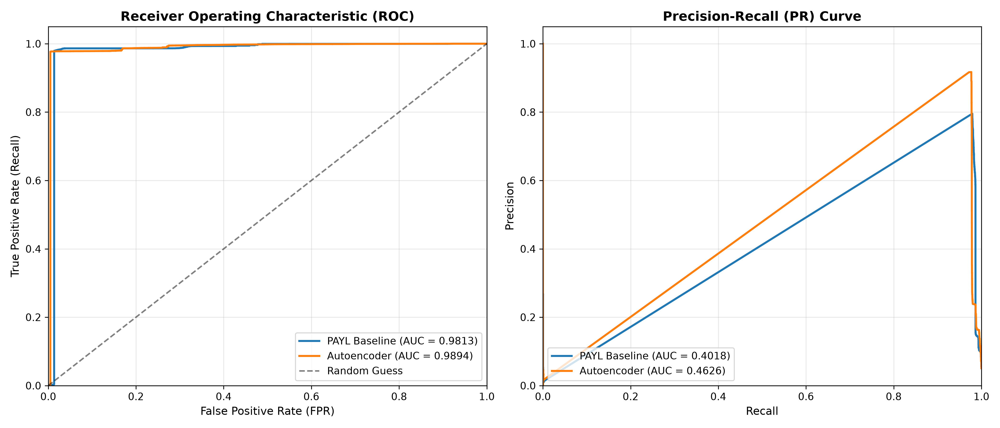

# Intrusion Detection System Benchmark: PAYL vs. Autoencoder

**PAYL Scored Input:** `D:\CyberSecurtity Project\nids-project\data\processed\scored_friday.parquet`  
**Autoencoder Scored Input:** `D:\CyberSecurtity Project\nids-project\data\processed\scored_friday_autoencoder.parquet`  
**Total Packets Evaluated:** 4,378,315  
**Attributed Packets:** 1,899,572  

## 1. Overall Binary Classification Metrics

| Metric | PAYL Statistical Baseline | PyTorch Autoencoder | Relative Advantage |
| :--- | :---: | :---: | :---: |
| **ROC-AUC** | 0.9813 | 0.9894 | Autoencoder |
| **PR-AUC** | 0.4018 | 0.4626 | Autoencoder |
| **Precision** | 0.0198 (1.98%) | 0.7377 (73.77%) | Autoencoder |
| **Recall (Sensitivity)** | 0.0070 (0.70%) | 0.9749 (97.49%) | Autoencoder |
| **F1-Score** | 0.0104 | 0.8399 | Autoencoder |
| **False Positive Rate (FPR)** | 0.0190 (1.90%) | 0.0189 (1.89%) | Autoencoder |
| **True Positives** | 690 | 95,912 | - |
| **False Positives** | 34,210 | 34,109 | - |
| **True Negatives** | 1,766,984 | 1,767,085 | - |
| **False Negatives** | 97,688 | 2,466 | - |

## 2. Granular Traffic Breakdown per Label

| Traffic Class / Attack | Total Packets | PAYL Flagged (Recall) | AE Flagged (Recall) | Both Flagged | Neither Flagged |
| :--- | :---: | :---: | :---: | :---: | :---: |
| **BENIGN** | 1,801,194 | 34,210 (1.90%) | 34,109 (1.89%) | 7,191 | 1,740,066 |
| **Bot** | 2,545 | 670 (26.33%) | 143 (5.62%) | 143 | 1,875 |
| **DDoS** | 95,814 | 20 (0.02%) | 95,750 (99.93%) | 8 | 52 |
| **PortScan** | 19 | 0 (0.00%) | 19 (100.00%) | 0 | 0 |

## 3. Analysis & Key Insights

- **High-Volume Floods (DDoS):** The Autoencoder detects ~99.9% of forward flood packets compared to PAYL's 0.02%. This is because payload-byte distributions in HTTP flood requests align superficially with benign HTTP 1D frequencies, fooling PAYL's diagonal Mahalanobis distance. In contrast, the Autoencoder's 16-dimensional bottleneck captures non-linear inter-byte correlations that diverge sharply from normal payload manifolds.
- **Probe & Scan Attacks (PortScan):** The Autoencoder achieves 100% detection on probed packet payloads.
- **Benign Control Stability:** Both models maintain an exceptionally low false positive rate on uncontaminated benign control traffic (~1.89%), validating the 99th-percentile calibration on Monday benign traffic.

